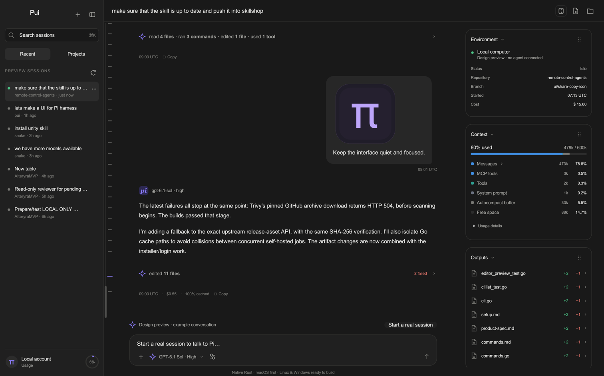

# Pui

A native desktop workspace for the [Pi](https://pi.dev) coding harness. Written in Rust with egui/eframe: no Electron; an on-demand embedded Chromium (CEF) browser handles HTML previews and web pages. macOS first, with a portable Linux/Windows foundation.



## Run

Requires **Rust 1.88+**, the platform's native build tools, and an installed/authenticated Pi CLI for real conversations. Pui doesn't manage provider credentials: sign in with `pi /login` in your terminal first.

```sh
cargo run -- --demo                # populated design preview; never starts Pi
cargo run -- --cwd /path/to/repo   # real workspace
cargo run                        # last chat and sidebar view (or a new chat on first launch)
```

On this Mac, Rust already exists but isn't on the shell PATH. If needed:

```sh
export PATH="$HOME/.rustup/toolchains/stable-aarch64-apple-darwin/bin:$PATH"
```

Pui starts a Pi RPC process automatically in a real workspace to load its configured model catalog, current model, and supported thinking levels. Demo mode never starts Pi. It never sends a prompt automatically. The bundled adapter adds tool-level permission checks (including nested codemode calls), with **Auto** as the default. Pi still runs with your local OS permissions: this is **not an OS sandbox**. Trusted extensions can execute their own code, and project trust remains Pi's responsibility.

### macOS application

```sh
./scripts/bundle-macos.sh          # release .app for this Mac's architecture
./scripts/bundle-macos.sh --debug  # quicker local build
open dist/Pui.app
open dist/Pui.app --args --demo
```

The bundle includes an app icon and a local ad-hoc signature, but no Developer ID signature or notarization. Pi is a separately installed dependency. Finder launches often lack your shell PATH; Pui adds common managed-Pi, nvm, Volta, and Homebrew binary directories to the child's inherited PATH without running shell startup scripts.

### Pi executable

Resolution order: `PUI_PI_BIN`, the managed install in `~/.pi/agent/bin/`, then `pi` on PATH (`pi.cmd` on Windows).

```sh
PUI_PI_BIN=/absolute/path/to/pi cargo run -- --cwd /path/to/repo
```

## Interface

The detailed layout follows `InspectorCards`, `MessageTimeline`, `Transcript`, and the neutral palette in the supplied `remote-control-agents` UI (read-only reference; that repository is not modified).

- Floating inspector cards fit their content automatically, capped at **420 logical pixels** (or 55% of the viewport in smaller windows) before the body scrolls. No card-height resize handles or saved manual heights. Click/keyboard-activate a heading to collapse completely to its header; the menu also offers Collapse all / Expand all and show/hide. Drag the grip to reorder; arrow keys on the grip move a card. Visibility, order and collapsed state persist; older saved heights are ignored.
- A thin conversation rail with exactly one mark per sent user message. Click to jump, drag to scrub, or use Alt+Up/Down while focused to move between messages. Crowded marks spread near the pointer.
- Activity stays between the prose updates that produced it. Compact verb/count summaries expand into plain read rows, inset command blocks, and inline colored edit replacements, with status/duration indicators. Codemode wrappers summarize actual nested actions from Pi metadata; expand to inspect child calls, JavaScript and results, including successful scripts. While running, older actions fold behind a muted chevron disclosure (no pill button); click or use Enter/Space to expand and collapse them. No generic Output/Copy/Arguments boilerplate.
- The **Outputs** card shows successful recorded session edits/writes—not Git status. The separate working-tree view is read-only. Replacement counts are recorded snippets, not necessarily a minimal Git diff; write counts represent supplied content, not inferred deletions.
- Context has a usage disclosure with cache and session totals. Pi RPC doesn't expose category sizes or the compaction reserve; real sessions explicitly say this instead of fabricating a breakdown. The full category example and PR cards in demo mode are labeled fixtures only.
- Light and dark three-pane workspace inspired by the supplied reference.
- Mixed Markdown styles (normal, bold, italic, links and inline code, including table cells and language fallbacks) share a typographic baseline and row-aligned selection/code backgrounds instead of aligning different font boxes independently. Preview with `cargo run -- --demo-markdown`.
- Agent Markdown tables render with shaded headers, cell borders, column alignment, selectable text, inline formatting and links. Long cells wrap; wide tables scroll horizontally without widening the conversation.
- Search recent local sessions; two icon-only sidebar buttons replace the Recent/Projects tabs and refresh button. **Group** (stacked sections) switches between **Recent** (flat list) and **Project** (repository folders, including subfolders/worktrees). **Filter** (narrowing lines) contains sorting by **Last activity**, **Creation time**, or **Name**, in either direction. Pinned chats live in a dedicated **Pinned** section above the list/groups, shown only when nonempty. They stay there regardless of grouping, search, archive/hidden filters, or the recent-session limit, until unpinned (or explicitly deleted). Project headings follow the same sort (project names or their newest chat timestamp), with five chats shown initially and Show N more / Show less. Creation time uses the Pi session header timestamp; unknown dates sort last. Last activity uses the discovered file modification time (including descendant activity), not a separately tracked last-event timestamp. Filter also contains **Show archived**. The chat list refreshes automatically when session files are created, renamed, updated or deleted, including changes from other windows and terminal Pi sessions. Filesystem events are coalesced; a background fallback scan keeps discovery current if watching is unavailable. No manual refresh is needed. The right-hand Group menu contains **Show hidden chats**; hidden chats can be restored individually from their chat menu using **Restore chat**, never via a bulk restore button. Resume in the session's original working directory. Reopening Pui restores the last open chat, grouping and sort options without sending a message or resuming queued work. Missing session files fall back to a new chat. Explicit `--session` takes priority; `--cwd` alone opens a new chat in that workspace. Demo/screenshot runs do not overwrite these preferences.
- Chat overflow menus: rename locally, pin, organize under a project, copy session path, export active-branch Markdown, archive, hide from Pui, or **Delete chat…**. Rename edits the title inline in Recent/Projects: Enter saves a nonblank name; Escape or clicking away cancels without stopping a run or sending a draft. Hide/archive keep the Pi session file; hidden chats can be restored. Delete requires explicit confirmation and permanently removes the saved transcript; project files/worktrees, child chats and tasks are kept (detached from the deleted chat). Stop active work and clear queued messages first; another Pui window's open chat cannot be deleted. External terminal Pi processes are not observable—close them before deleting their session.
- **Delete task…** is available from the task's sidebar overflow/right-click menu and task view. After confirmation it removes the task record, checks/results and saved task-run transcripts, not its parent chat, project files or Git worktree. Running tasks must be stopped first. Saves/deletes share one ordered storage worker; task locks and a content-free deletion marker prevent stale saves from resurrecting a deleted task. Demo mode never deletes saved data.
- Real streamed assistant text, selectable CommonMark text/code, copy controls, collapsed reasoning and tool output.
- New sessions, stop, searchable Pi model selection in a compact upward-opening dropdown with a quiet inset search field, provider filtering, pricing/context metadata, and a discrete thinking slider. Choices come from Pi's `get_available_thinking_levels` for the confirmed current model, not hard-coded model-name guesses. The composer shows model name, provider only if ambiguous, and capitalized effort.
- **Subagents have one supported launch path: `pui_spawn_agent`**, available in ordinary writable chats without enabling Ultracode. Workers appear as clickable child chats beneath their creator, with independent live transcripts and status. Optional `cwd` targets another local repository; writable workers still get isolated Git worktrees. The tool-boundary guard rejects recognized unmanaged CLI/SDK agent launches through Bash, PowerShell and codemode, including inline Python/Node subprocess launches and alternative subagent tools, even in Bypass mode. Errors direct the agent to `pui_spawn_agent`; denied/unavailable spawning must be reported, not bypassed. CLI help/version discovery and ordinary development commands remain available. This guard is not an OS sandbox: obfuscated commands, saved scripts and arbitrary third-party tools cannot be exhaustively inspected. Already detached terminal agents are not retroactively adopted or assigned fabricated live status.
- **Ultracode** is a separate per-chat orchestration toggle beside the effort slider, not an invented provider reasoning level. It adds proactive workflow guidance and enables native codemode as the script coordinator; it no longer gates managed spawn/list/message/wait/stop tools. Guidance asks for the fewest useful workers (including zero), bounded tasks, minimal explicit messages, and review/verification. Normal permission policy, Plan mode and read-only worker restrictions still apply. See [research and design sources](docs/ultracode-research.md).
- **Pui → Cron jobs & monitors** lists each job's creating agent (click to open its chat), command/schedule, workspace, next/last run, delivery count and errors, with Pause, Resume and confirmed Delete. Agents use **`pui_create_monitor`**, **`pui_create_cron`**, **`pui_jobs`** and **`pui_update_job`** without enabling Ultracode. Monitors execute a bounded shell condition in their creator's saved workspace (default every 60s, 30s timeout; configurable 10–86400s interval, 1–300s timeout). Exit **0** sends one bounded event back to that creator and completes the monitor; exit **1** quietly keeps waiting, other failures are visible in the jobs view. Scheduling/checking uses **no AI and no context**; only event or scheduled-prompt handling starts an agent response and consumes tokens. Commands run with local OS permissions, not a sandbox; use side-effect-free checks. Auto/Manual require explicit approval of future execution, Don't ask/Plan reject creation, and read-only/verified-task workers cannot create jobs. Bypass skips approval but never the unmanaged-agent launch guard. Cron sends the saved prompt to its creator on a **five-field numeric UTC** schedule (`minute hour day month weekday`; `*`, lists, ranges, steps; Sunday 0/7; restricted day/weekday use OR). Jobs run **only while Pui is open**. Private durable storage restores enabled jobs and automatically reconnects their creator sessions on relaunch **without sending a prompt**; queued work/history is not replayed, and missed cron occurrences are skipped. Busy/compacting/approval/history-navigation states defer event delivery and coalesce occurrences instead of building a prompt backlog. Stop/Stop tree pauses that agent's jobs; quitting keeps enabled jobs for next launch. Delivery awaits RPC acceptance; uncertain/in-flight deliveries pause for explicit review rather than retrying automatically. One elected window owns scheduling/storage, other windows show a refreshed read-only view and take over after it closes. A creator open in another window is shown as blocked, not duplicated. Preview with `cargo run -- --demo-automation` (fixtures only, no commands/provider calls).
- **Pui → Agents board** opens a read-only Kanban overview of live chats, background agents/subagents, verified-task agents and sessions in other current-build Pui windows. Columns show **Working**, **Waiting for input**, **Idle**, **Error**, plus **Queued** / **Stopped** when present. Filter by project or main agents; click a card to open its conversation or task without stopping other agents or granting pending approvals. Cards show actual activity/questions, model and time in the status since first observed on the board. Connecting, history navigation and compaction stay under Working with their specific activity labels. Saved-only history and external terminal Pi processes are not presented as live agents. Narrow windows scroll horizontally; each column scrolls vertically. **Back to chat** or Escape returns without aborting work. Preview without provider calls using `cargo run -- --demo-kanban`.
- One parent/child hierarchy in the sidebar: regular subagents appear only beneath the chat that created them, never again as duplicate top-level saved chats or a separate Agent workflows list. Task workflows nest beneath their recorded creator, with routing/proposal/builder/check/verifier runs beneath the task. Children stay independently clickable; task runs open the existing supervisor transcript/evidence rather than starting another Pi session. Both Recent and Projects keep the tree together; project counts/five-chat limits count roots, not workers. Child rows are compact, single-line entries with task/agent icons, a status dot and full status on hover; indentation and disclosure arrows replace faint branch connectors. A small arrow beside each parent shows/hides its whole child group without switching chats; Enter/Space or Left/Right also work on the focused arrow. Collapsed branches persist, and searching a child shows its ancestor chain. Older tasks without recorded creator metadata remain clearly labeled task groups; ownership is never guessed from names. Each regular worker retains its own Pi RPC process, transcript, draft, model state and live status. Click to chat directly while the parent keeps running. Parent/descendant-only messaging, event-driven script waits (no transcript/progress chatter), one bounded completion report when not collected by a wait, Stop tree, and confirmation before quitting with active agents. The concurrency ceiling is configurable (default 4, 1–16), not a target team size; extra workers queue.
- Read-only workers have a tool allowlist and no shell/MCP/discovered extensions; this is **not an OS sandbox**. Writable workers receive isolated detached Git worktrees from committed HEAD. Uncommitted parent edits are not copied. Worktrees and sessions are kept—never auto-committed, merged, pushed or deleted. Parent-child links are saved with Pui preferences and reopen as saved/stopped sessions; pending tasks, script execution and in-memory queues are not automatically resumed.
- Explicit connected/idle/working/waiting-for-input/compacting status for the attached Pi process in the sidebar and inspector. Live progress appears **after all transcript outputs/images**, outside the composer, with rotating short verbs and a subtle glyph; connecting, approval and compaction retain truthful labels. Progress has a fixed row height, animates only when visible/active, and disappears when idle. **Stop** sits immediately left of Send; right-click Stop for Stop tree when a workflow is present. Other session files are labeled Saved rather than falsely reporting live status; external terminal agents are not observable through this RPC connection.
- A compact, left-aligned waiting queue with **Send now**, edit and delete icons. Settings choose **Steer** (default: the next turn/tool boundary) or **Queue** (after the current run settles). Enter uses your default; Cmd+Enter / Ctrl+Enter uses the other behavior. Steering stays editable locally until the adapter opens a turn boundary; acceptance releases that boundary. **Send now interrupts the current run**, then sends the selected message after Pi confirms cancellation and idle; other local waiting messages stay queued. Completed edits/external actions cannot be undone and tool cancellation can take time. The selected message appears immediately as a pending chat bubble (**Interrupting current run…**, **Sending to Pi…**, then **Sent to Pi · waiting for agent**) until the canonical user message replaces it without duplication. Receipts are presentation-only, never injected into Pi history/model context, and are shared with attached windows. Images stay attached; compaction and approval dialogs defer delivery. Rejected sends return to the waiting queue; uncertain sends remain visible and are never retried automatically. Stop clears the queue and cancels an interrupt-then-send handoff. The queue/receipts are in memory only.
- A compact sidebar header keeps app controls below the macOS traffic lights, with a **Pui** menu, New chat and separate icon-only Filter and Group controls. macOS has native **Pui / File / Edit / View / Window / Help** menus: About, Settings, New Chat/Window, Open Project, standard text editing, search/layout/files/changes/terminal/zoom, window actions, and guarded Close/Quit. **View → Theme** selects Light/Dark; **Pui → Completion Alerts** switches sound and desktop notifications (macOS only), and **Pui → Default Message Delivery** selects Steer/Queue. These use Settings’ saved values, apply live, and show current checkmarks, including changes made from Settings or a shared chat. The in-app Pui menu uses the same supported-action definition. Empty Services and ineffective cross-process Bring All to Front entries are omitted; context-dependent actions are disabled when unavailable. No browser Reload/Developer Tools entries. New Window is a separate process; Quit closes this process/window through its active-agent confirmation, leaving independently opened windows running.
- **Check for Updates** is manual-only, using stable GitHub Releases and semantic version tags (`v1.2.3`). The release repository is intentionally unset: **Check for Updates is hidden from both menus until a valid repository is configured**, and no request is made. When ready, build with `PUI_GITHUB_REPOSITORY=OWNER/REPO ./scripts/bundle-macos.sh`. The current version comes from `Cargo.toml`, also copied to the app bundle. Checks use an unauthenticated, bounded GitHub API request via Pi’s existing Node prerequisite; private repositories need a future authenticated distribution design. Pui never downloads/installs/restarts itself or interrupts agents. Signing/notarization and automatic installation remain future work.
- **Settings** is a dedicated full-window view with sidebar navigation, search, Back to app and grouped cards—not a floating dialog. Open it with the composer settings icon or Cmd+, / Ctrl+,. Pages cover General, Appearance, Notifications, Keyboard shortcuts, Permissions, Models, Providers and Resources; only supported controls are exposed. All pages share aligned rows, grouped cards, typography and a 32-point control height for buttons, tabs, search fields and navigation. Toolbar icons and Tasks use the same height; chat controls and sidebar Show more remain compact. Appearance supports saved Light/Dark themes and eight color styles, plus layout and scale. Dark styles are **Midnight** (navy/blue), **Forest** (evergreen/mint), **Plum** (aubergine/lavender), and **Classic** (original charcoal/violet); light styles are **Ivory** (warm cream/terracotta), **Sage** (sage/green), **Rose** (blush/berry), and **Classic** (original white/violet). The Light/Dark switch shows only the four matching theme previews. Click a preview card to apply it immediately without changing modes or interrupting agents. Each mode remembers its own style across switches and restarts. Classic is the default in both modes, preserving the original colors. Midnight, Ivory, and the other styles are opt-in. Dark remains the default mode. System-following mode is not implemented. Agents keep running while settings are open. General includes auto-compaction at **50–95% of context used** (default 85%) and recent context retention (default 20,000 tokens, capped at half the trigger budget for small models). The adapter uses Pi's canonical compaction preparation/summary generation and persisted boundary drafts, not raw transcript slicing. Overflow recovery remains enabled. Requires a compatible managed Pi SDK or `PUI_PI_SDK` pointing at `dist/index.js`; unavailable overrides are explicitly reported. Settings affect Pui processes only, not user/project Pi files.
- **Settings → Resources** is a full-width native manager with **Library**, **Workspace** and **Packages & sources** views. Library has purpose/source/state filters and a persistent inspector rather than expandable settings cards. Workspace shows personal defaults, project overrides and effective configuration together (a matrix in wide windows, compact rows when narrow). **Inherit / Enable here / Disable here** use Pi's actual exact-path and package-delta filters; personal defaults are edited separately. Packages group resolved resources by source ownership, show locally installed versions/missing declarations, and preview affected resources before uninstalling. Local resources, MCP definitions and built-ins remain distinct sources. Search with `/`, select rows with arrow keys, and explicitly read bounded local UTF-8 source previews (64 KiB, no symlinks); nothing is executed to preview it. Guided MCP HTTP/stdio forms support exposure, JSON arguments and advanced patches, preserving omitted credentials. Register local paths, install npm/git/local packages, exclude local resources, or remove MCP entries. Changes are **drafts** until a helper validates a shared review and shows generated resource-field diffs (sensitive MCP fields redacted) or package operation plans. Apply revalidates the config revision and review token, runs sequentially and reports each result; successful operations remain applied on failure, remaining drafts require another review, and no rollback/automatic retry is promised. Package installs/removals must be applied separately from later package-filter rewrites in the same file. Browsing never connects to MCP, loads extensions or installs missing packages. Enabled means configuration, not connection health. Project resources remain hidden/locked until trusted with Pi. Local exclusions keep source files; package removal keeps local source directories; MCP removal keeps OAuth credentials. Changes affect future Pi processes, not running agents—reopen Pui to reliably reload. Use environment references rather than literal secrets and Pi `/mcp` for OAuth/live diagnostics. Requires a compatible managed SDK or `PUI_PI_SDK` pointing to `dist/index.js`. Demo fixtures allow in-memory draft/selection simulation only; they never modify configuration.
- **Permissions:** Auto (default), Manual, Accept edits, Plan, Don't ask, and Bypass all permissions. Switch modes from the composer picker beside the model selector or Settings → Permissions. Manual approves inspection tools and asks for each other call. Accept edits adds canonical workspace edits and bounded local `mkdir`/`mv`/`cp`; scripts/network/unknown tools still ask. Plan blocks mutations, delegation, codemode and arbitrary shell, allowing only inspection tools and a tiny read-only shell grammar; approve the written plan and change mode to implement. Don't ask allows the bounded preapproved set and denies all permission-requiring actions without a dialog. Bypass requires an explicit warning confirmation and skips Pui tool approvals/classification for writable agents. Read-only workers remain restricted.
- **Auto permissions** actually call the lowest-priced suitable text model available in the current provider and configured scope, ranked by configured input + output token prices (ties by model ID; zero prices may be provider placeholders). Canonical workspace edits and bounded local mkdir/mv/cp proceed without a classifier round-trip. Other calls are checked for dangerous effects, not narrow task relevance, using the proposed action and up to eight recent user requests (bounded to 18,000 characters total). It has no tools and does not see the full conversation. It uses a 12-second deadline and at most 256 output tokens. Standard actions matching the request can proceed; destructive/high-risk actions bypass automatic approval and ask. Classifier failure, missing pricing/model/auth, malformed output, uncertainty or a classifier denial falls back to explicit per-call approval, not a hard denial. Uncertainty never implicitly approves a call. Source text mentioning dangerous words is not treated as executing them. This is probabilistic intent classification, not a security sandbox or Claude's proprietary classifier. Classifier calls cost provider usage, are recorded in Pi custom entries and shown separately from session chat cost in Settings. Permission/compaction settings remain editable while agents work, including from attached windows, and apply to existing and future Pui workers. Changes affect subsequent tool calls/context checks, not commands or summaries already executing. Changing permission mode invalidates outstanding approvals; unchanged modes are not invalidated by compaction-only updates. Read-only worker restrictions always win.
- Real session cost and current context-window usage from Pi; manual compaction. Chat history displays the complete saved active branch, including messages before compaction and original content before model-only context edits. Summary text is hidden; a **Context compacted** separator marks each recorded compaction without changing the model’s compacted context.
- Git status with read-only diffs against HEAD, refreshed on workspace/session changes, run completion, or explicit refresh. No idle polling, staging, commits, or pushes.
- **Settings → Notifications → Agent completion** has independent **Play completion sound** (on by default) and **Show OS notification** (off by default) switches. macOS plays its Glass sound and uses native Notification Center banners, including while Pui is foregrounded. Turning OS notifications on requests permission; denied permission/delivery errors are shown in Settings, and Focus/system volume rules still apply. Notifications show only the bounded chat/worker name, not the response/transcript. A successful observed `agent_settled` triggers once; intermediate `agent_end`, tools, compaction, history loading, disconnected/aborted/stopped/failed runs do not. Local queued follow-up work defers the alert until that work completes. Background chats/workers notify through their owning process, never through attached mirror snapshots. Alert preferences persist and can be changed during a run or forwarded from an attached window. These alert backends currently support **macOS only**; Linux/Windows controls are explicitly disabled.
- **Agent questions** use `pui_ask_questions` in ordinary chats and Ultracode: one or several questions, single-choice or multi-select (`multiSelect: true`), with optional explanations beneath each option. Normal option sets are fully visible; unusually long content scrolls. Single-choice clicks advance immediately. Answers use shortcut cards (design B): a separate numbered badge, aligned title/description column, and a checkmark for selected answers. Multi-select waits for an explicit **Next question / Submit & continue** action. **Something else** accepts free text (also alongside multiple selections); **Skip** records an unanswered question. Previous/next chevrons preserve answers and drafts across chat switches. Number keys **1–9** select/toggle the matching card, including **Something else**; they remain ordinary text while editing a custom answer. Answering the last question returns one batch to the existing Pi tool call and automatically continues—no extra Send or injected user prompt. Cancel ends the question tool without granting consent; Stop aborts its wait. Arrow/number keys work without sending your composer draft. The completed **Your answers** card stays in the transcript above the agent's continuation, including across history reloads and shared windows; skipped questions are explicitly labeled. Preview with `cargo run -- --demo-questions` or compare designs interactively with `cargo run -- --demo-question-designs` (no provider calls).
- Confirmed **chat deletion** runs in the background: the dialog closes immediately, and the sidebar shows a red spinner with a Deleting status while other chats, new chats and tasks remain usable. Only the deleting chat is unavailable; failures show an error and allow retry. Successful deletion plays the completion sound on macOS when enabled in Settings → Notifications, without an agent-completion banner. Task deletion retains its waiting confirmation.
- App confirmations (quit, stop terminal, history restore/fork) use compact centered dialogs with wrapped explanations, bounded scrolling details and always-visible right-aligned actions. Destructive actions are clearly red, Cancel is focused by default, and Escape/backdrop cancel without stopping a run. Bypass and resource changes reuse the action styling inline. Preview with `--demo-confirmation` (no provider requests).
- Model choices remain clickable during active runs: Pi changes the model for subsequent requests without restarting the response already streaming. Model name/provider update only after acknowledgment; rejection preserves current model/effort choices. Disconnected/loading/compacting/history-navigation states show an explicit reason instead of silently ignoring clicks.
- Pi extension confirmation, choice and answer prompts appear inline directly above the composer, not as global modals. Permission prompts show the exact command/path, remaining arguments, Allow once and Deny. Bodies wrap and scroll separately from always-visible response buttons. Empty bodies reserve no space; short choice lists are fully shown with wrapped labels, while longer lists scroll. Prompt drafts stay with their chat. Shared approvals route to the owner and stale dialog IDs cannot approve another action.
- Project/sidebar **+** and Cmd+N / Ctrl+N immediately open a blank chat in that project/current workspace, without a native dialog. The new-chat view lets you choose an existing project or explicitly **Open folder…** in the native picker. Switching the project keeps your unsent text/images; cancelling the picker changes nothing, and stale picker results never redirect another chat. The original connection, draft, images and approvals remain parked while existing work continues.
- Approval cards display decoded, selectable code/commands and separate before/after fields rather than escaped JSON. **Cmd+Enter / Ctrl+Enter** allows once; **Cmd+Backspace / Ctrl+Backspace** denies, taking priority over composer keys. **Always allow** remembers only the exact tool + arguments + workspace for the current chat connection (up to 256 rules); mode changes, session switches and reconnects clear it. Nested calls still require their own approval. Older adapters support Allow once/Deny only.
- Composer ↑/↓ recalls up to 100 previously sent user messages **from the current session only**, including attachments. At the first/last visual line, arrows browse history; within multiline drafts they move the cursor normally. Moving past the newest prompt restores the unsent draft; recalled drafts/cursors do not cross chats. Messages are not sent automatically.
- **Fork** sits after an assistant response and creates a separate chat **including that response**. The original session, draft and files stay unchanged; the new chat starts with an empty composer and shares the workspace. User messages have inline **Copy**, **Edit**, and **Rewind** icon buttons matching the assistant footer, with no actions menu. Copy stays available during runs; Edit/Rewind require an idle owning window. They return directly to the composer when checkpoints verify no file changes, or when file restoration is unavailable (files are always kept in those cases). Otherwise a single dialog offers **Keep current files**, **Restore files and conversation**, or **Restore files only**, with file-change counts when known. Unknown/legacy checkpoint ranges are not treated as unchanged. Only file-restoring actions use a destructive confirmation; a redundant pi-rewind extension menu is answered with **Keep current files** during that exact navigation, never a second file restore. Rewinding stops before the selected prompt and waits with its text/images in the composer—never automatically reruns anything. The current unsent draft is retained for manual recovery. Later conversation entries remain in Pi’s append-only session tree; use Pi’s tree UI to revisit abandoned branches. History changes currently require the owning Pui window and an idle chat with no waiting deliveries.
- **Code restoration is deliberately bounded:** checkpoints capture built-in/nested `edit` and `write` file bytes in the workspace (4 MiB per file, 128 files and about 16 MiB per prompt). Shell commands, unknown mutating tools, missing old checkpoints, symlinks/protected paths, concurrent same-file edits, or conflicts disable/refuse code restore. Every affected file is checked before changes; a private recovery manifest is kept before restoration. Other owned agents must be idle, but external processes/windows are not an OS-level lock. Only captured files are restored—not external side effects, Git state, directories, deployments or purchases. Checkpoints/recovery copies are private local app data in `pui/checkpoints-v1`, are not sent to models, and persist until manually removed.
- Streaming uses Pi's indexed content-block events: each text/thinking block is rebuilt from its own deltas, and completed block contents replace the reconstruction. This avoids transient doubled first words when `message_start` already contains a shallow first-token seed. Current Pi RPC omits snapshots on updates; older snapshot-based and unindexed delta adapters remain supported. Full snapshots and `message_end` are authoritative; genuine repeated words are retained.
- The top-right **Files** button opens a docked panel: selectable previews/open-file tabs on the left, a searchable expandable folder tree on the right, and an expand/restore control. Folders load only on expansion; searching scans names, never contents, with bounded results. Explicit clicks, the path/URL bar, and `pui_open` read content. Markdown defaults to a rendered **Preview** with a **Source** toggle; code/text uses selectable monospace text with line numbers. PNG/JPEG/GIF/WebP previews decode on workers (16 MiB input, 8192px sides, 64 MiB decoder allocation limit; animated formats show a still). Sensitive paths, symlinks in the tree, binary/non-UTF-8 text and text files over 512 KiB are blocked. Directory listings are bounded to 2,000 entries; open previews to 16 tabs. Refresh reloads expanded folders and the selected file. Explicit opens support absolute files outside the workspace (including `/tmp` reports), rechecking canonical sensitive paths and blocking file symlinks. `pui_open({target:"/tmp/review.md"})` lets the agent present its main deliverable instead of only printing a path; it acknowledges viewer opening, not completed content loading, and never returns file contents to the agent. Background chats cannot steal the visible workspace; read-only workers and verified-task builders retain their existing allowlists. Local previews are allowed in Plan mode; URL opens use normal tool permissions. Works during active runs and in narrow windows without switching chats, starting Pi, or idle polling.
- The adjacent **Changes** button opens a docked, expandable panel with path search and separate **Current Git / Recorded edits** tabs. Click rows to expand selectable, line-numbered inline diffs with addition/deletion counts. Recorded edits remain in session order, not a net Git diff, and work without a Git repository. Git status and per-file diffs load on workers; Refresh invalidates cached diffs. Files, Changes and Session details are mutually exclusive.
- The top-right **Terminal** button beside Files opens a resizable bottom dock with an interactive PTY shell, starting in the active project's working directory (including subfolders/worktrees). Each workspace keeps its own shell while switching chats/projects. Hide/reopen preserves running commands; expand/restore fills the workspace. Stop asks for confirmation, and closing Pui warns while shells are open. Supports ANSI/256-color/truecolor output, Unicode, keyboard navigation, Ctrl-C, bracketed paste, drag-to-select/copy and 2,000 lines of scrollback. Shell I/O/spawn/resize/reaping run on workers with output-driven repaints, not idle polling. Terminal output is local only, never sent to Pi. Shells are window-local and do not survive quitting Pui. Demo mode renders a fixture without spawning a shell.
- Native folder picker, persisted workspace/card preferences, responsive inspector, locally loaded macOS fonts. Explicit language fallbacks cover the composer, transcript, bold Markdown, code and labels. Hebrew glyphs are guaranteed by bundled OFL-licensed Noto Sans Hebrew, with SF Hebrew preferred on macOS. Other scripts use available local language fonts (including broad Unicode/CJK fallbacks); no runtime downloads. A local egui/epaint patch applies the Unicode Bidirectional Algorithm per paragraph and wrapped line, keeping Hebrew reading order, mixed English/numbers, pointer caret positions, plain arrow navigation and selection consistent without reversing saved/copied/sent text. Grapheme order and mirrored brackets are preserved. **Not full support for every language:** Arabic/Indic complex-script shaping, precise combining-mark positioning and dual-affinity carets at mixed-direction boundaries still need a shaping-aware editor. See `vendor/README.md` for patch scope and upgrade notes. Preview with `cargo run -- --demo-languages`. The embedded font license is available under About → Font license.
- Clearly labeled, isolated demo fixtures. Demo conversations are never saved to Pi.
- Attach **any regular file**, including CSV, PDF, JSON, archives and source files, through the composer **+** picker or drag/drop. Up to eight attachments; non-images are limited to 64 MiB each and show removable filename/size cards. Non-images are privately copied to local app data (`pui/attachments-v1`) and referenced in the Pi prompt so the agent can read/process them with its tools. Copies survive source changes, chat switches, queue edits and restarts; they are not automatically deleted because saved chats reference them. Binary/document interpretation depends on the agent's available tools—not provider-native document upload. PNG/JPEG/GIF/WebP retain native RPC image blocks, 8 MiB/24-megapixel limits and image previews. Image paste (Cmd-V on macOS; + right-click for clipboard) remains available. File I/O/encoding is off the UI thread.
- Type **/** at the start of the composer for searchable command completion: Pi extension commands, prompt templates and `/skill:name`, plus native `/new`, `/model`, `/settings`, `/compact [instructions]`, `/stop`, `/files`, `/browser`, `/terminal` and `/help`. TUI-only commands such as `/login` are not forwarded as ordinary prompts; use the Pi CLI. Type **@** at a word boundary to find workspace files by path/name and insert an absolute reference (quoted for spaces); selection does not read file contents. Filename search is bounded/cancellable and uses the file browser's sensitive/symlink/generated-directory exclusions. **↑/↓** selects, **Tab/Enter** inserts without sending, **Escape** dismisses without stopping the agent; Enter again sends. Clicking a result also inserts. Completions and outstanding file-picker results remain scoped to their chat.
- User-message bubbles have a footer-aware minimum width, so timestamps and Copy/Edit/Rewind actions stay underneath even for short or image-only messages. Pending-message Copy/status labels share the same baseline. Sent-image thumbnails are inside the user bubble. Exact trailing Pi image-resize/coordinate notes are hidden when backed by image attachments; raw message text, saved sessions, exports and model context remain unchanged. Quoted/inline examples, non-matching text and notes without attachments are preserved. Historical screenshot paths are replaced only when Pi already returned matching read-result image bytes; no historical filesystem reads. Theater overlay preserves source resolution up to the GPU texture limit and uses Retina-aware sizing. Click the image to toggle fit/zoom, or use the wheel/pinch; drag-to-pan is bounded to overflowing axes only. Click the backdrop, the close icon, or Escape to dismiss. On-screen/keyboard arrows, Home/End, and a bottom thumbnail strip navigate images. Bounded asynchronous decoding/cache; GIF/WebP display a still frame.
- The separate **globe / Browser** button opens **Chromium/CEF** for HTTP/HTTPS pages (including localhost); the **folder / Files** button opens local files. Browser and file tabs/selections are kept separately, with only the active pane highlighted. Opening an empty browser shows an address-entry page without navigating or starting Chromium. Use **View → Browser** or `/browser` as alternatives. `pui_open` and clicked links automatically select the matching pane. Native controls provide Back/Forward, Reload/Stop, an address bar, **DevTools** (Chrome Elements/Console/Network/Sources in a separate native window), an **Inspect** element picker, and a bounded inline **Console** (300 messages, 4,000 characters/message, never agent context or disk logs). **Responsive / Desktop / Tablet / Mobile / Custom** presets set real Chromium device metrics; fixed profiles have Fit, rotation and page zoom. Mobile/tablet also emulate touch and an Android user agent—not Safari/iOS or a real device. The UA affects subsequent requests; reload after switching when testing server-side device detection. Each tab retains its DOM, navigation history and in-memory cookie context while hidden, until closed or the workspace/window changes. The macOS preview browser is explicitly **Keychain-free**: no saved browser passwords or persistent cookies, no shared “Chromium Safe Storage” lookup. CEF’s mock-Keychain backend is restricted to these session-only contexts; it must not be used for a persistent authenticated profile. Browser process bookkeeping uses a fresh private temporary directory on each launch, never an older browser profile. Temporary bookkeeping is not automatically removed after crashes; it is not a persistent login store. If an older build asks for “Chromium Safe Storage,” choose **Deny** and quit/relaunch the updated app—do not grant access merely to silence the prompt. The fix does not edit existing Keychain items or their access controls. This is not a persistent browser profile or automation API; pages have no Pi IPC/tool bridge or remote debugging port. Downloads, popups, file dialogs, camera/microphone and permission requests are blocked. Non-HTTP page navigation and embedded URL credentials are refused. Local HTML is a self-contained script/network-free CSP preview with **Source**; use localhost HTTP for interactive HTML apps.
- Chromium packaging currently supports **macOS** (Apple Silicon validated; Intel packaging defined but untested). Windows/Linux retain text/Markdown/images and HTML Source; Chromium integration there is not implemented yet. CEF is pinned to `156.0.26` (Chromium `156.0.8078.88`) and ships sandboxed helpers, framework, license and credits; security updates require rebuilding/releasing Pui. The local debug bundle is about **377 MiB**. Build with CMake/Ninja on PATH: `./scripts/bundle-macos.sh --debug`. The script fetches the exact distribution into `target/cef-runtime`, verifies its pinned size/SHA-1 from the official index, and packages/signs helpers. Set `CEF_PATH` to a compatible preinstalled distribution to reuse it. `cargo run` supports file/Markdown/image viewing, but Chromium requires the app bundle. Preview with `dist/Pui.app/Contents/MacOS/pui --demo --open http://localhost:3000 --browser-device mobile --browser-console`; `--open` also works in real chats.
- Clickable HTTP/HTTPS links and bare URLs open inside Pui; mailto still uses the OS handler. Markdown file links and inline absolute file paths (like `/tmp/review.md`) open the file viewer; relative links in a document resolve beside that document. Text stays selectable. Lists/inline code use a common line height/alignment, with compact item spacing and no link underlines.
- Read-only GitHub PR state, checks and review decision in the Pull requests card, plus inline check markers/link hover details. Looks up explicit PR URLs from user/assistant prose using local authenticated `gh`, never source patches or thinking. Refresh is event-driven/manual, not periodic. Inaccessible PRs show unavailable rather than inferred status.
- Sidebar account usage ring/popover with LiteLLM budget, remaining allowance, reset date, month-to-date spend/requests, all-time spend and model breakdown. Pi resolves credentials locally in a short-lived Node helper; only aggregates reach Rust. No credentials are logged, stored in Pui preferences, or sent to Harbor. The gateway must permit `/user/info` and `/user/daily/activity`; HTTP 403 is shown as unavailable, not substituted with session cost. Set `PUI_PI_SDK` to Pi's `dist/index.js` for non-managed installs, and `PUI_USAGE_PROVIDER` if the provider is not named `litellm`.

The session list is a read-only bounded scan of up to 150 recent JSONL files in Pi's default session store, plus explicitly pinned/hidden paths retained in preferences so they stay reachable. Titles prefer explicit Pi names, then the first nonblank user prompt (or “Image attachment”); empty chats show “New conversation.” Discovery finishes large first-prompt JSONL records rather than truncating at 96 KiB, with a 96 MiB hard bound and a 32 KiB name tail. Connected-chat titles update from live history/name events without overwriting local renames. It honors `PI_CODING_AGENT_DIR` and `PI_CODING_AGENT_SESSION_DIR`. Custom `sessionDir` settings require that environment override. Histories are loaded through Pi rather than replaying the on-disk session tree ourselves.

### Multiple windows

Pui coordinates **one live Pi owner per session file** across current-build app processes. Open the same chat in a second window to attach to the owner instead of launching another Pi writer. Live transcript/tool activity, images, run/compaction state, cost/context, permission dialogs and waiting messages are shared. Send, queue, Send now, edit/delete, Stop, model/effort, and chat permission/compaction settings route to the owning window. Queue edits use a revision check; an obsolete approval cannot approve a later dialog. Drafts, selection and scroll position remain window-local. Layout, local session organization preferences and the entire agent-supervisor UI are not globally mirrored.

A shared composer says **Shared · another Pui window**. Switching the owner to another chat parks its connection so attached windows keep working. This can retain more idle Pi processes until the owner exits. Closing the owner still owns the agent lifecycle: active work prompts for confirmation, and sessions/worktrees remain on disk. An attached window reports the owner unavailable; reopen the chat to reconnect. There is no automatic process takeover, workflow replay, or retry of uncertain messages; retained drafts can be restored explicitly. Closing an attached-only window does not abort the owner.

Coordination uses exclusive OS file locks, a user-private local registry, authenticated loopback IPC and native filesystem notifications—not periodic idle scans or Git polling. Streaming publications are coalesced. Full structured snapshots are encoded/decoded off the UI thread on attachment/update; very large histories can be expensive and have a 192 MiB transport bound. All participating windows must use this build: **reopen older Pui windows**. Independent terminal Pi processes and pre-sync Pui versions do not implement this ownership protocol and cannot be live-synchronized.

### Shortcuts

| Action | macOS | Linux / Windows |
| --- | --- | --- |
| New session | ⌘N | Ctrl+N |
| Search sessions | ⌘K | Ctrl+K |
| Toggle sessions | ⌘B | Ctrl+B |
| Toggle inspector | ⌘I | Ctrl+I |
| Send / default busy behavior (Steer initially) | Enter | Enter |
| Other busy behavior | ⌘Enter | Ctrl+Enter |
| New line | Shift+Enter | Shift+Enter |
| Stop | Escape | Escape |

The inspector hides automatically on narrower windows. Switching views parks active chats with their Pi connection, drafts, images, queue, approvals and in-flight deliveries; their work continues. This does not depend on live-window coordination being registered. Clicking back restores the same connection instead of restarting or aborting it. A pending chat connection does **not** lock the sidebar: clicking a different chat supersedes it, with the old process retired in the background and its events/preview receiver discarded. Chat row widget IDs follow session file paths, not list positions, so refresh, pinning, search and project grouping do not redirect pointer presses. Stop clears any pending queue before requesting abort.

Saved chats open a bounded, read-only 2 MiB tail preview on a worker while Pi initializes its tools/MCP connections. This preview follows the active parent chain and is presentation only: Pi's RPC history remains authoritative for model context. Partial previews are labeled in the top bar. Full-history parsing/tool-result reconstruction uses Pi’s raw `get_entries` response and selected leaf on the stdout reader, not the UI thread; the preview-to-history swap preserves the reading anchor. Coordinated session connections are retained per chat to preserve single ownership across windows. Non-coordinated same-working-directory switches reuse Pi `switch_session`; replaced connections retire/reap off the UI thread.

MCP/extension warnings are deduplicated in the top-bar **bell** notification popover, not inserted above the composer. Session updates and connection warnings have separate cards, with individual dismiss and **Clear all** actions. Escape or clicking outside closes the popover without clearing its contents or stopping a run. MCP troubleshooting and a copyable Pi CLI `/mcp` command appear only for relevant diagnostics; a remote 503/closed connection still requires service recovery. Pui does not disable your configured servers.

Verified-task proposal and verifier agents intentionally return strict JSON for validation, not ordinary prose. Pui renders valid role responses as readable acceptance-check or review cards, including when their saved role session is reopened; the unchanged JSON remains under **Raw response** and Copy still copies the original response. Proposed commands are explicitly not execution results. Ordinary chat JSON is not automatically reformatted. The Workflow inspector shows the current attempt’s numbered stages, with prior attempts retained in Results & evidence. Current-session workers are separate from the collapsed **Other sessions** list; truncated names, objectives and model labels expose their full text on hover.

## Resource use

- Native egui/eframe + OpenGL, Chromium initializes only on the first HTML/page open. CEF uses its external message-pump scheduling (not an always-on UI animation loop); hidden tabs retain their page state and may still run ordinary browser background work until closed.
- Worker results wake the UI; there is no recurring repaint timer or periodic Git scan. The RPC worker blocks on commands and is woken on stdout EOF, rather than checking the process every 25 ms while idle. Live-window registry updates encode JSON before writing and never wake their own publisher or rescan its own metadata; other windows wake only after their registry scan completes.
- Markdown parsing is frame-cached. Settled transcript groups cache heights; offscreen groups skip rendering and text layout. Tool details stay unlaid-out until expanded (small successful diffs display inline). Thumbnails reserve identical geometry while pending, ready, failed or evicted; texture completion and unrelated clicks never invalidate all transcript heights. Offscreen attachments do not start decoders during measurement.
- Real workspaces start a Pi RPC process for configuration discovery. Managed workers add separate Pi processes and provider usage; they inherit the parent model/effort at launch, with Pi clamping unsupported levels. Worktree preparation runs off the UI thread. UI measurements exclude Pi/providers. Usage refresh is event-driven/on-demand with a five-minute throttle, not a recurring idle timer. A pending workflow wait schedules only its deadline repaint, not a polling loop.
- Earlier pre-image-support measurements are not current resource guarantees. Measure the present release with the intended history/window size. Window/GPU buffers, image textures and Pi's own subprocess can be substantial.

Use `cargo run --release -- --demo` for performance measurements. Debug builds are not representative. High-DPI memory use is still a tuning target.

## Verified development tasks (first slice)

Use **New task** in the sidebar, or **Tasks** in the workspace bar. Tasks appear as cards in their creating conversation. Opening a linked task keeps the chat history and composer, with checks, approval and results in the same scroll. **Conversation** returns to the creator (including saved parents); unrelated chats are never shown as task context. Task controls are UI-only, not synthetic Pi messages. Chat messages do not change or approve the task contract. Acceptance checks are readable cards with **Edit check** on demand. Shared expandable sections replace stock triangle disclosures across task results/settings, routing details, usage, raw responses, reasoning and app dialogs: rounded full-width rows, line icons, useful summaries, optional status badges and a right-side +/− control. Click anywhere on the header or use Enter/Space and Left/Right; focus is visible, long titles stay bounded with full text on hover, and failed checks open by default. The task picker and its menu rows truncate within a bounded width, with full titles on hover. The Workflow inspector (including its collapsed summary), Tasks button and picker are scoped to the exact chat session, not the workspace or window-wide last selection. Chats without tasks show no task workflow; opening a task explicitly from the sidebar/board keeps that task's own context. Saved session ownership survives restart; unlinked legacy tasks are never assigned to chats by name or directory.

1. Enter an objective and constraints. New tasks default to **dynamic per-stage routing**; older saved tasks stay pinned unless explicitly changed. A tool-free, lowest-priced available Haiku assessment chooses a model and effort for each proposal, builder and verifier stage. It uses task scope, risk, acceptance checks, previous failures and provider-reported pricing: Haiku for explicitly easy work, Opus 5.5 / GPT-6.1 Sol for harder work. Fable/Astra require a substantive exceptional justification and a separate human approval **before** launch. Only the current task provider's available, positively priced policy models are eligible; invalid output, missing models or a model/effort mismatch blocks instead of silently substituting. **Generate acceptance checks** explicitly authorizes the routing and read-only proposal calls, not implementation.
2. Review/edit 1–8 criteria and their exact commands. At least one executable check is required. **Approve checks and start** freezes the contract and authorizes implementation, fresh verification, and at most **two repair rounds**. Tool permissions remain separate; task approval is not a blanket tool grant.
3. Git tasks use a retained detached worktree from the inspected committed HEAD. Dirty source requires an explicit **committed HEAD only** choice; uncommitted changes are never copied or silently omitted. A changed HEAD blocks execution. Non-Git tasks work in place without an extra location prompt.
4. The builder uses bounded workspace file tools; shell, codemode, ambient extensions/MCP and delegation are disabled for this initial implementation. A separate Pi check process runs the approved commands through the existing `user_bash` permission gate. Tests/builds execute project code with local OS permissions: **not a sandbox**.
5. A fresh read-only verifier sees the objective, frozen contract, candidate edits and actual command results—not the builder's rationale. It must cover every criterion and report blocked when required behavioral evidence is missing. Failed checks cannot be overridden by positive prose. Checks, review and acceptance are tied to a bounded SHA-256 source fingerprint; source changes make evidence stale. Acceptance always recomputes it.
6. Review **Results & evidence**: recorded candidate replacements, command exit status/output/duration, independent findings and unresolved blockers. **Accept this result** records your decision only; it does not commit, merge, push or deploy.

The right-side **Workflow** card uses a connected vertical step timeline with numbered pending steps, completed checkmarks and an emphasized active step—not text arrows. It shows acceptance checks, builder, check runner, fresh verifier and result, including repair attempts, waiting states and per-task reported cost. Click agents for live transcripts or a bounded saved-session preview; click checks/results for evidence. **Open** lives in the card header before the drag handle and remains accessible when collapsed. The card is automatically exposed for a new task and otherwise follows normal inspector collapse/hide/reorder controls. In narrow windows the main task view remains available when the inspector is hidden.

Task state/evidence is written privately under local app data `pui/tasks-v1` (0700 directory / 0600 records on Unix); Pi session files and worktrees are retained. A restart marks active tasks **Interrupted** and never replays prompts or shell effects. This version allows one task execution per Pui window; work does not survive closing the owning app, and task orchestration is not mirrored across windows. An optional reported-spend threshold prevents further launches and aborts active work when reported cumulative/streamed usage reaches it. Routing calls count toward usage. This is **not a guaranteed hard dollar cap**: delayed accounting and in-flight requests can overshoot. Each pending agent operation/check has a 30-minute deadline; cancellation cannot undo completed external effects. Source fingerprints cover Git tracked/nonignored files (whole repository), or a bounded non-Git tree excluding generated directories; they are not a filesystem snapshot or external-process lock.

Provider-free preview:

```sh
cargo run -- --demo-task
cargo run -- --demo-task --light --screenshot /tmp/pui-task-light.png
```

Fixtures exercise the builder/check/verifier lifecycle and model routing without provider calls, including the first interaction regression `task_draft_survives_chat_switch`. **Model choices & routing reasons** records the exact provider/model/effort, reason, stage, attempt and reported cost, including router calls. A failed builder is reassessed and cannot repeat Haiku indefinitely. Routing is a policy-guided model judgment, not a proven optimum; quality, escalation rate, cost and latency still need comparative evaluation.

An explicit proposal-only CLI drives the **same supervisor** without opening an ordinary chat:

```sh
cargo run -- --task-proposal /absolute/path/to/request.json
```

The JSON request has `source`, `provider`, `model`, `thinking`, `objective`, `constraints`, and positive `spend_limit` fields. Optional `parent_session` records the originating chat for sidebar grouping; it grants no execution approval. This command incurs provider usage, saves the task, prints proposal evidence, and exits at **AwaitingApproval**. It never approves the contract, starts a builder or runs proposed checks. Interactive prompts and exceptional-model requests stop safely. Do not put credentials in the request.

Pilot 1 used the unchanged overflow baseline, Haiku 5.5 as router, and GPT-6.1 Sol (Medium) as the selected proposal model. It stopped at **AwaitingApproval**, reporting **$0.0118831** total for both model runs. No builder/check/verifier run occurred. The proposed contract still needs human review for manual checks and local tooling availability; this establishes routing/proposal functionality, not improved development quality.

## Architecture

```text
src/app.rs        desktop state and interaction
src/app/views.rs  workspace bar, floating inspector and conversation layout
src/app/files.rs  docked file tree, name search, explicit read-only previews and tabs
src/app/changes.rs docked Git/recorded-edit search and expandable inline diffs
src/app/terminal.rs project-local docked terminal, selection and keyboard rendering
src/terminal.rs   background PTY shell, bounded VT parser, I/O and process lifecycle
src/app/sidebar.rs repository grouping, chat menus and account footer
src/app/model_picker.rs upward Pi catalog/provider/search/effort dropdown
src/app/settings/resources.rs resource-manager state, staged selections and background helper lifecycle
src/app/settings/resources/ native Library/Workspace/Packages UI, forms, review, transport and tests
scripts/resources.mjs safe Pi resource discovery, package operations and MCP config patches
src/app/attachments.rs general file loading/retention, picker/drop and clipboard image previews
src/app/completions.rs cursor-aware slash commands and filename-only @ completion
src/app/run_status.rs visible lifecycle state, waiting queue and delivery tracking
src/app/agents.rs parent/child RPC supervision, explicit mail/waits, isolation, tree persistence
src/tasks.rs     verified-task domain, frozen contracts, evidence and recovery
src/tasks/       routing policy/validation, proposal request, private storage and source fingerprints
src/app/tasks/   task supervisor, approval/results view and right-side workflow
scripts/ultracode.ts bundled Pi tools and orchestration guidance (no separate agent loop)
src/pulls.rs      read-only explicit-link GitHub PR status
src/media.rs      bounded background decoding, stable thumbnail slots and viewer
src/history.rs    bounded read-only saved-chat tail preview
src/usage.rs      LiteLLM account budget popover and helper lifecycle
src/tool_view.rs  quiet tool rows, commands and inline edit diffs
src/inspector.rs  content-sized cards, bounded scrolling, disclosures, menus, reorder
src/transcript.rs cached/culled turns, message rail and expandable activity
src/activity.rs   tool summaries and successful recorded outputs
src/context.rs    reported context metadata and usage disclosure
src/app/prompt_ui.rs Quiet Mac dialogs, inline prompts, anchored popovers and explicit actions
src/theme.rs      colors, typography, shared surfaces
src/icons.rs      vector icons, no icon font dependency
src/markdown.rs   selectable CommonMark and diff rendering
src/protocol.rs   testable Pi event/state reducer
src/rpc.rs        JSONL subprocess transport and lifecycle
src/sessions.rs   read-only local session discovery
src/workspace.rs  background read-only Git inspection
```

Pui communicates with `pi --mode rpc` over stdin/stdout JSONL. Process output is read continuously; stdout is protocol-only and stderr is drained but not persisted/displayed because extensions can log sensitive values. Commands use request IDs. Completed messages replace streaming snapshots. A run is idle only on `agent_settled`, not `agent_end`. Shutdown closes stdin, waits briefly, then terminates/reaps an unresponsive child.

## Development / validation

```sh
cargo fmt --check
cargo clippy --all-targets -- -D warnings
cargo test
node --test tests/*.test.mjs
cargo run -- --demo --screenshot /tmp/pui.png
cargo run -- --demo-about --light --screenshot /tmp/pui-about.png
cargo run -- --demo-updates --light --screenshot /tmp/pui-updates.png
cargo run -- --demo-questions --screenshot /tmp/pui-questions.png
cargo run -- --demo-files --light --screenshot /tmp/pui-files.png
cargo run -- --demo-changes --light --screenshot /tmp/pui-changes.png
cargo run -- --demo-terminal --screenshot /tmp/pui-terminal.png
cargo run -- --demo-notifications --screenshot /tmp/pui-notifications.png
cargo run -- --demo-kanban --screenshot /tmp/pui-kanban.png
cargo run -- --demo-send-now --screenshot /tmp/pui-send-now.png
cargo run -- --demo --light --screenshot /tmp/pui-light.png
cargo run -- --demo-settings --settings-page Appearance --light --screenshot /tmp/pui-settings-light.png
cargo run -- --demo-settings --settings-page Resources --screenshot /tmp/pui-resources.png
cargo run -- --demo-settings --settings-page Resources/Workspace --light --screenshot /tmp/pui-resources-workspace.png
cargo run -- --demo-settings --settings-page Resources/Packages --screenshot /tmp/pui-resources-packages.png
cargo run -- --demo-expanded --screenshot /tmp/pui-expanded.png
cargo run -- --demo-collapsed --screenshot /tmp/pui-collapsed.png
cargo run -- --demo-theater --screenshot /tmp/pui-theater.png
cargo run -- --demo-model-picker --screenshot /tmp/pui-picker.png
cargo run -- --demo-agents --screenshot /tmp/pui-agents.png
cargo run -- --demo-task --screenshot /tmp/pui-task.png
cargo run -- --demo-task-proposal --screenshot /tmp/pui-task-proposal.png
cargo run -- --demo-compacting --screenshot /tmp/pui-compacting.png
cargo run -- --cwd /path/to/repo --session /path/to/session.jsonl
```

The screenshot option captures the app and exits; use `--demo` to avoid including private session titles. Tests include simulated card clicks, right-click menus and drag/drop, preference roundtrips, rail jumps/viewport culling, activity expansion, protocol lifecycles, ordered text/tool reconstruction, Unicode-safe JSONL framing, and a deterministic mock Pi subprocess. The Unix transport fixture requires Python 3. No test sends a provider request.

Validated locally on **Apple Silicon macOS**. Linux and Windows have **not** been built or tested. eframe/winit, the folder picker, paths, and process boundaries are cross-platform; Linux builds will need their distribution's graphics/window-system development packages. Platform-specific packaging, CI, signing, and notarization are future work.

## Deliberate v0.1 limits

Ultracode is a first implementation of parent-supervised native Pi workers, not full Claude Code feature parity: no durable JavaScript workflow replay, automatic dirty-working-copy integration, per-workflow hard spending budget, or automatic model-tier router. The parent dynamically delegates through native codemode and Pui's tools; execution quality still depends on the selected model. Workers inherit the chosen model, not a silently substituted expensive tier. Multi-agent behavior is validated with fixtures; no paid-provider multi-agent run has been executed. Agents running separately in terminals are not given fabricated live status. No full session-tree browser, login UI, syntax highlighting, or full extension widget rendering yet. The terminal is a basic VT-compatible pane, not a full replacement for a dedicated terminal emulator (no mouse-reporting, terminal tabs, or persistent shells after app exit). Edit/Rewind and response-level Fork use Pi’s canonical session tree, but revisiting abandoned branches still uses Pi’s tree UI. The waiting queue is local/in-memory, and cannot inspect messages already queued by another client in Pi. Use the Pi CLI for the remaining workflows. Intermittent UI flashing reported by the user has not been reproduced conclusively; repeated-frame, image-readiness, reading-anchor and late-state lifecycle regressions are covered but are not proof that every visual glitch is resolved.
