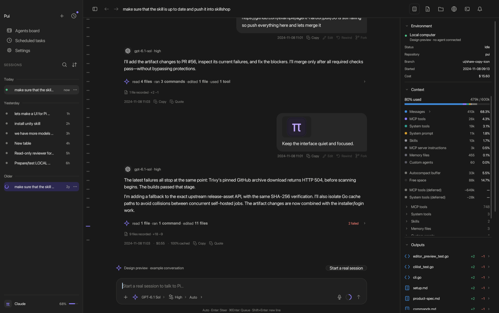
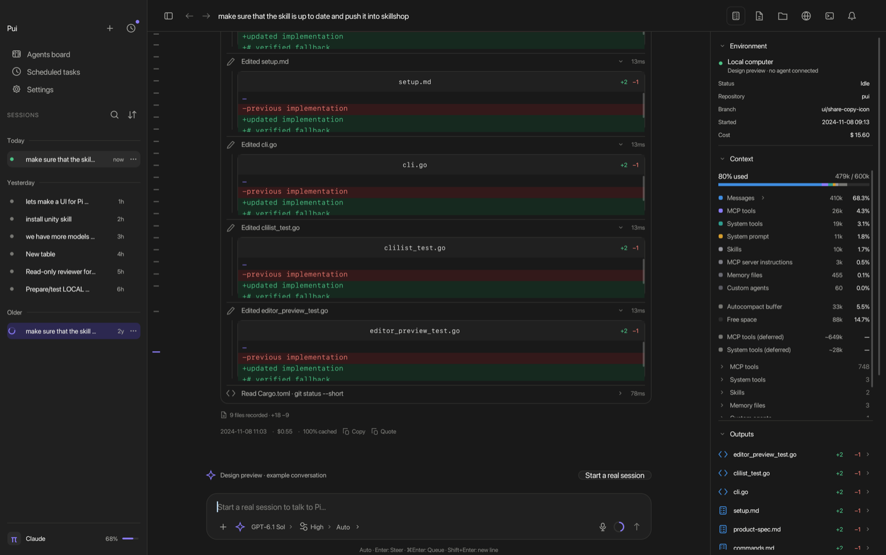
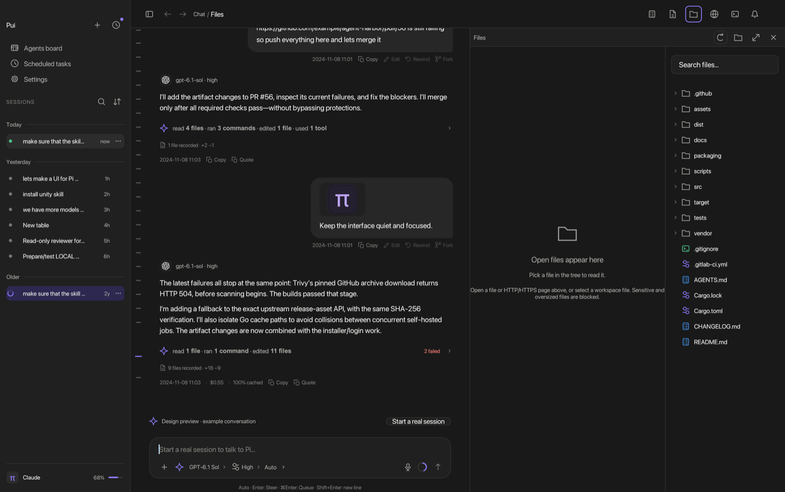

# Pui

**A fast, native Mac app for the [Pi](https://pi.dev) coding agent.**

Chat with your agent, watch what it does, review its changes and run several agents side by side, all in one quiet window. Pui is written in Rust (no Electron) and ships with everything it needs, including Pi itself.



## What you get

- **Everything in one place.** Chats on the left, the conversation in the middle, and context, cost and changed files on the right.
- **See what the agent did.** Every action (files read, commands run, edits made) is grouped into a short summary you can expand.
- **Stay in control.** Choose how much the agent may do on its own, per chat, from the bottom of the composer.
- **Run agents in parallel.** Spawn subagents in their own Git worktrees; each one is a chat you can open and talk to.
- **Batteries included.** Pi, Node.js, ripgrep and fd come inside the app. Nothing else to install.
- **Light and dark**, several color themes, and full keyboard control.

## A quick tour

### Follow the work as it happens

Actions collapse into one line, such as *read 4 files · ran 3 commands · edited 1 file*. Expand it to see each command, its output, and inline diffs of every edit.



### Review every change

The Changes panel lists what the agent edited, hunk by hunk, next to the conversation. The Outputs card keeps a running list of changed files.


### Find anything with ⌘K

One search box covers chats, message text, files and settings.


### Files, a browser and a terminal built in

Browse the workspace, preview files and web pages in the built-in browser, and open terminals without leaving the app.



### Know when an agent needs you

A badge collects chats that finished or are waiting for an answer, even ones running in the background.


### Light mode, too


## Install

1. Download the latest **Pui.dmg** (Apple Silicon) from [Releases](https://github.com/RebliNk17/pui/releases).
2. Drag **Pui** into Applications.
3. Open it. The app isn't notarized yet, so macOS blocks the first launch: open **System Settings → Privacy & Security** and click **Open Anyway** next to Pui. See [unsigned builds](docs/releases.md) if you prefer to verify the download first.
4. In **Settings → Providers**, sign in or add an API key for your model provider.
5. Pick a project folder and start chatting.

**Already using Pi?** On first launch Pui finds your existing Pi folder (`~/.pi/agent`) and offers to move it into Pui. Your providers, logins, models, skills and chats come along. The original files stay where they are, so the Pi command line keeps working. You can also copy settings over again later from **Settings → General → Pi data**.

## Permission modes

Choose a mode per chat from the composer. New chats start in the last mode you picked (Auto the first time).

| Mode | What the agent can do without asking |
|---|---|
| **Auto** | Routine development. A small, cheap model checks each risky action, and dangerous ones are blocked. |
| **Manual** | Read files. Everything else asks first. |
| **Accept edits** | Read and edit files in the workspace. Commands and network access ask first. |
| **Plan** | Read-only. The agent writes a plan for you to approve. |
| **Don't ask** | Safe reads and workspace edits. Anything else is refused silently. |
| **Bypass** | Everything. Use only for work you trust. |

Subagents run in their parent's mode or a stricter one, never a looser one. Permission checks are tool-level guards, not an operating-system sandbox.

## Build from source

You need Rust 1.88+, CMake and Ninja (`brew install cmake ninja`).

```sh
cargo run -- --demo              # a populated design preview; never starts Pi
cargo run -- --cwd /path/to/repo # open a real project
./scripts/bundle-macos.sh        # build dist/Pui.app
```

Tests: `scripts/test-rust.sh` and `node --test tests/*.test.mjs`. See [test execution](docs/test-execution.md).

## Learn more

- [Full reference](docs/reference.md): every feature and design decision in detail
- [Bundled runtime](docs/bundled-runtime.md): what ships inside the app and how providers are set up
- [Releases and CI](docs/releases.md): how builds are signed and published
- [Changelog](CHANGELOG.md)

Pui is built and tested on Apple Silicon macOS. Linux and Windows are not supported yet.
