# Pui

**A fast, native Mac app for the [Pi](https://pi.dev) coding agent.**

Chat with your agent, watch what it does, review its changes and run several agents side by side, all in one quiet window. Pui is written in Rust (no Electron) and ships with everything it needs, including Pi itself.


## What you get

- **Everything in one place.** Chats on the left, the conversation in the middle, and context, cost and changed files on the right.
- **See what the agent did.** Every action (files read, commands run, edits made) is grouped into a short summary you can expand.
- **Stay in control.** Choose how much the agent may do on its own, per chat, from the bottom of the composer — with an upgraded sandbox-aware Auto mode (custom allow/deny rules, interactive fallback, and distinct denial badges) plus optional OS-level macOS Seatbelt sandboxing on shell commands.
- **Subagents, background tasks & dynamic workflows.** Spawn interactive child sessions in the sidebar (fresh or forked from the current conversation, plus one-tool mid-task handoff, shared family notes, and family-wide messaging), or run lightweight background subagents, async shell commands, and phased multi-agent workflows inside the **Background tasks** pane.
- **Pull requests & autonomous browser verification.** Track PRs, CI checks, merge conflicts and review comments in a dedicated **Pull request** pane with optional background **Auto-fix**, and let agents drive Pui's built-in Chromium browser while you watch live and can take over anytime.
- **Stay in flow.** Follow live per-turn step plans, click one-tap next steps in the end-of-turn wrap-up box, launch proposed follow-up sessions in one click, and run single-line shell blocks straight in the built-in terminal.
- **Batteries included.** Pi, Node.js, ripgrep and fd come inside the app. Nothing else to install.
- **Light and dark**, several color themes, and full keyboard control.

## A quick tour

### Follow the work as it happens

Actions collapse into one line, such as *read 4 files · ran 3 commands · edited 1 file*. Expand it to see each command, its output, and inline diffs of every edit.


### Review every change

The Changes panel lists what the agent edited, hunk by hunk, next to the conversation. The Outputs card keeps a running list of changed files.

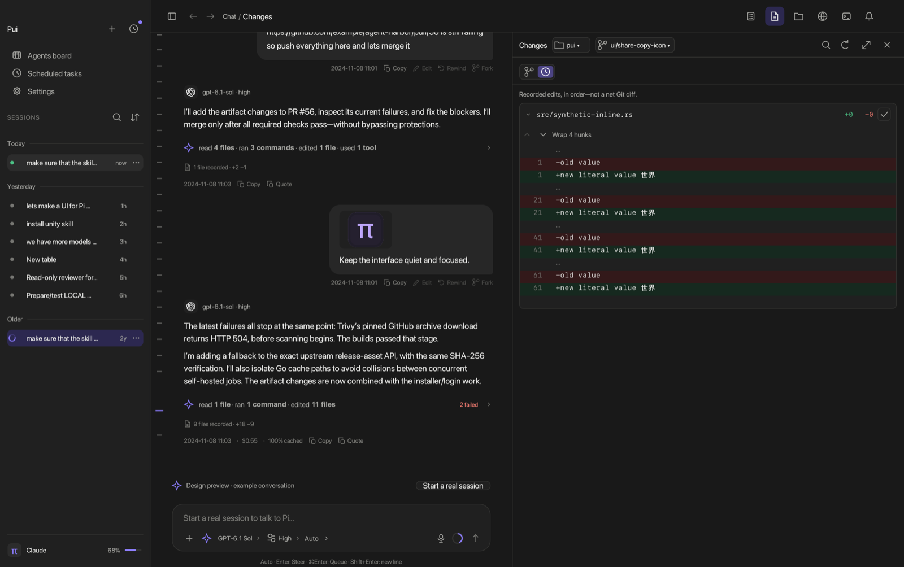

### Find anything with ⌘K

One search box covers chats, message text, files and settings.

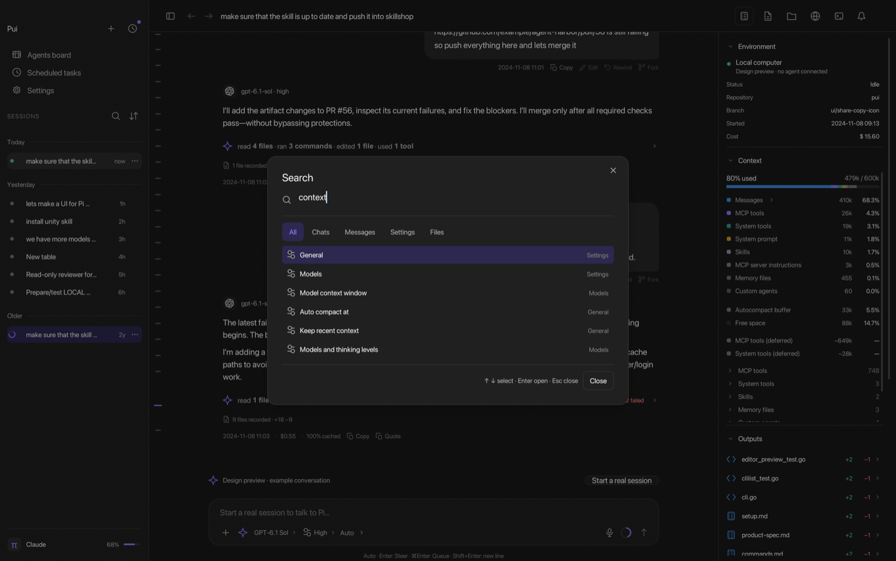

### Pull request pane & PR Auto-fix

Bind any GitHub pull request (`pui_pr_bind`) or auto-detect the current branch's PR to inspect CI checks, merge conflicts, and review comments side by side with chat. Turn on **Auto-fix** (`pui_pr_autofix`) to watch the PR in the background (~30s) and automatically wake the chat on new CI failures, merge conflicts, or review comments — without ever enabling GitHub auto-merge.

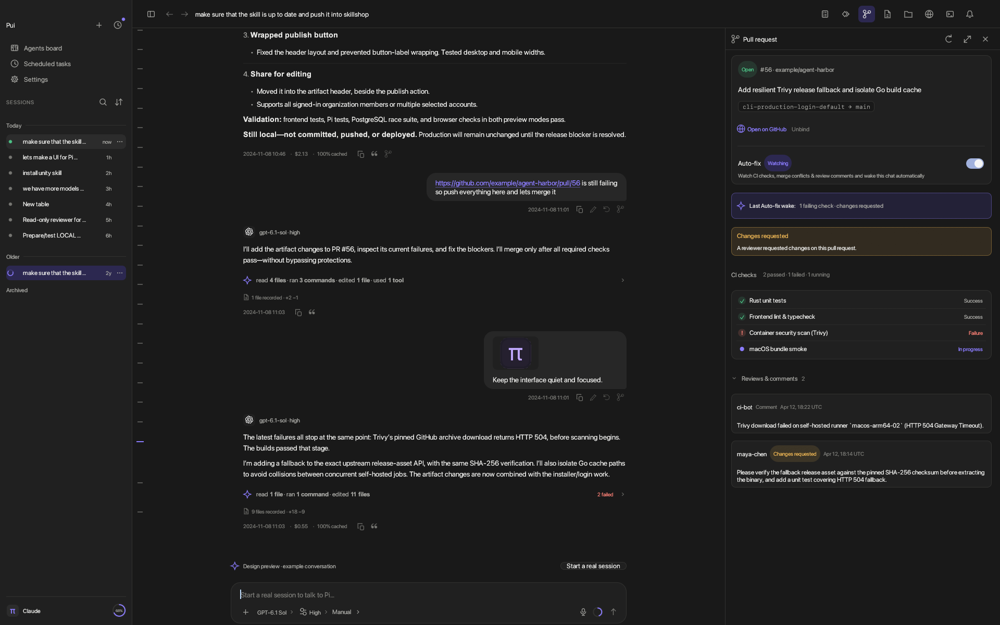

### Dynamic workflows, background tasks & side-session collaboration

Run phased multi-agent workflows, lightweight non-sidebar background subagents, and long-running background shell commands from the **Background tasks** pane — with a live 6×6 status micro-grid, collapsible phase rows, per-agent token/time tables, surfaced errors, and one-click Stop.

For independent work that outlives a turn, sidebar child sessions (`pui_spawn_agent` / `pui_handoff_session`) support `context: "fork"` (inheriting the parent's conversation history), a shared per-family notes folder (`PUI_FAMILY_NOTES_DIR`), family-wide sibling messaging (`pui_message_agent`), batched completion wakes (`<side-sessions-event>`), and clickable `[title](#agent/<agent_id>)` session links.

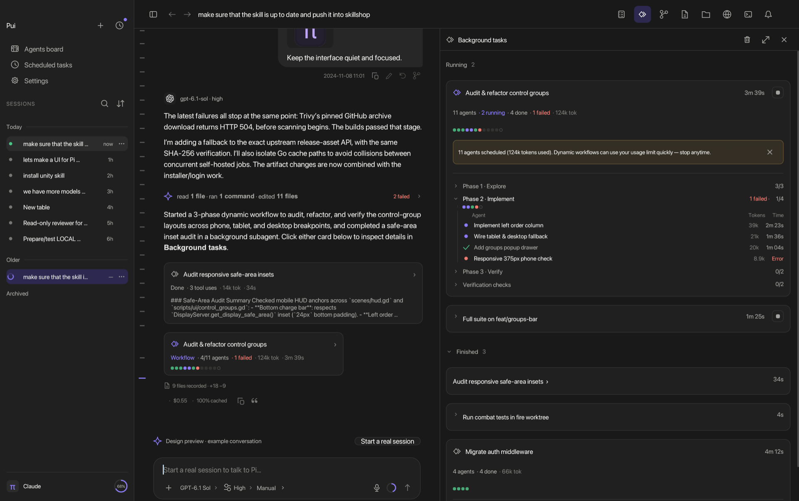

### Inspect agent results cleanly

Click any background subagent card (in chat or in Background tasks) to open its Detail View: prompt brief, model, expandable tool summary, full Markdown-rendered response, and settled stats (`tool uses · tokens · duration`). Host completion reports render as quiet collapsible cards in the parent transcript.

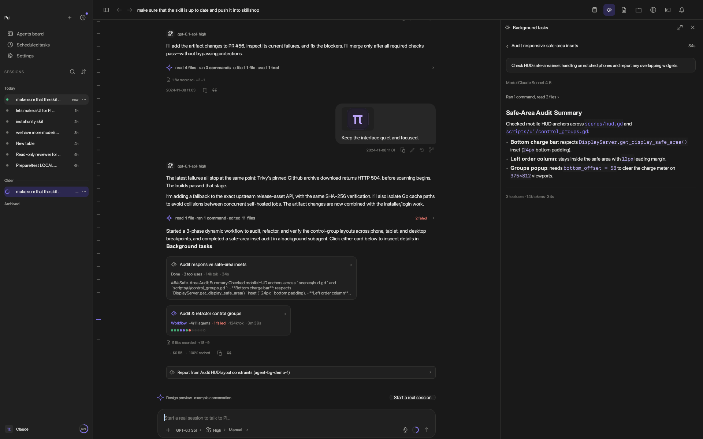

### Live turn plans, wrap-up actions & follow-up proposals

Multi-step turns pin a collapsible progress strip above the composer (`pui_update_plan`), finish with a recap and clickable quick-reply buttons (`pui_wrap_up`), and surface independent follow-ups as one-click session proposal cards (`pui_propose_session`).

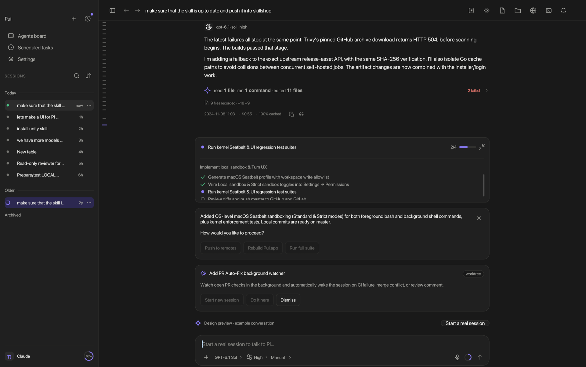

### Files, an agent-driven browser and a terminal built in

Browse the workspace, preview files and web pages in the built-in Chromium browser, and open terminals without leaving the app. Agents can also drive the visible Browser pane directly (`pui_browser_navigate`, `pui_browser_read`, `pui_browser_act`, `pui_browser_screenshot`, `pui_browser_console`) to verify localhost dev servers and forms while you watch live and can take over anytime. Single-line `bash`/`sh`/`zsh` code blocks get a one-click **Run** button, and replies can deep-link straight to a specific terminal tab (`#terminal/<tab_id>`).


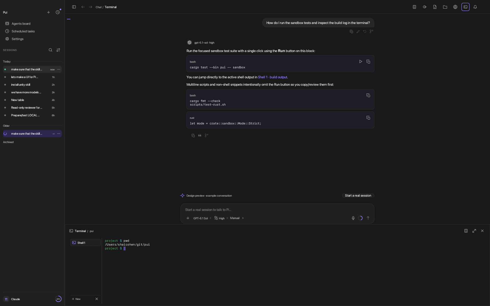

### Know when an agent needs you

A badge collects chats that finished or are waiting for an answer, even ones running in the background.

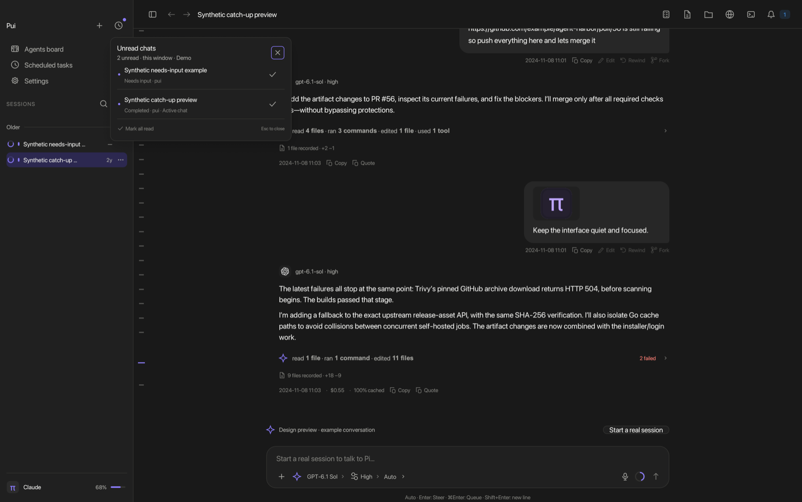

### Light mode, too

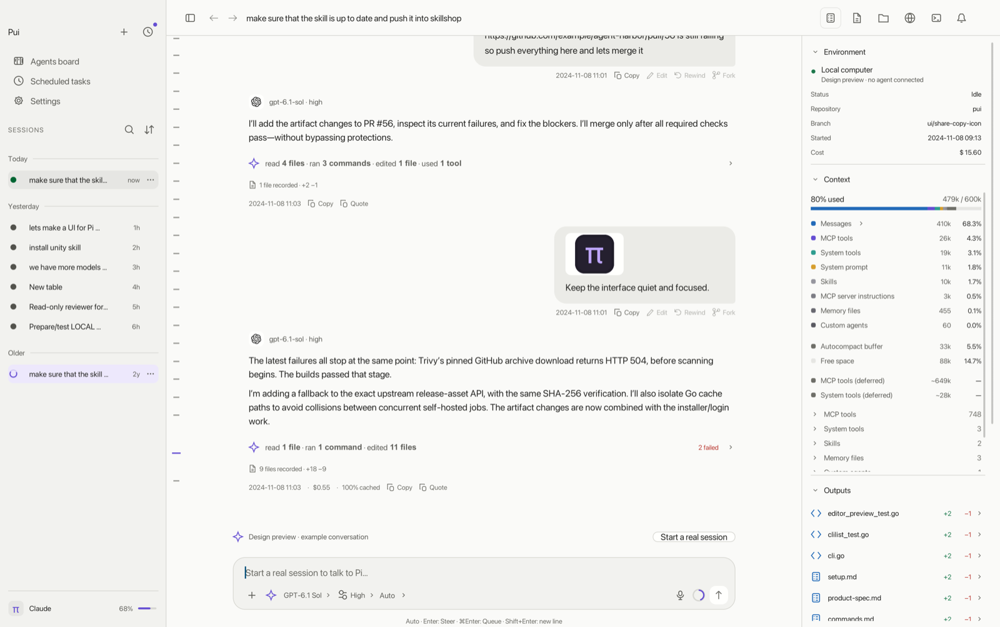

## Mobile companion (Android)

Control Pui from your Android phone over your private [Tailscale](https://tailscale.com) network—no cloud relay or third-party servers required.

<p align="center">
  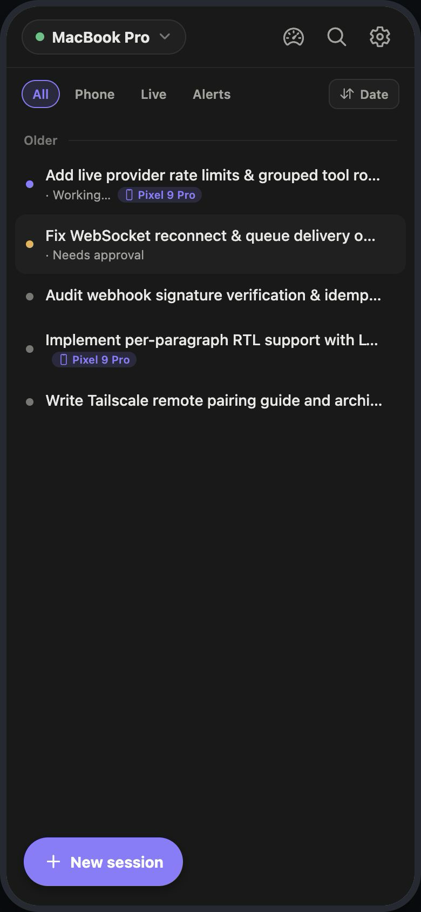
  &nbsp;&nbsp;
  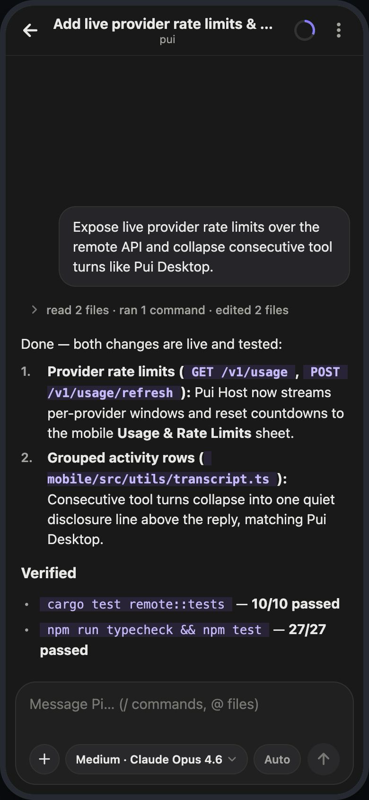
  &nbsp;&nbsp;
  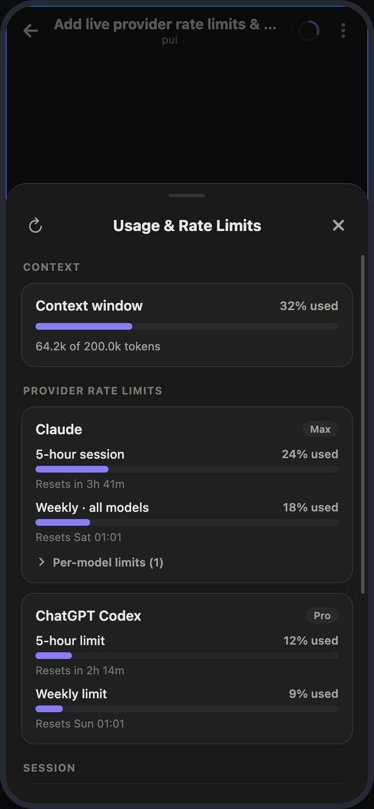
</p>

### What it does

- **Parallel sessions.** Open, start, or message any chat from your phone without switching or interrupting the chat open on your Mac.
- **Full agent control.** Watch live streaming replies and grouped tool activity, queue or steer follow-ups while Pi is working, attach photos, use `/` commands and `@` workspace file mentions, and switch models, effort levels, or permission modes.
- **Approvals, questions & notifications.** Approve or deny tool calls, answer `pui_ask_questions` prompts, and get native Android notifications over Tailscale when an agent finishes replying or needs your input (with optional background keep-alive).
- **Files, diffs, artifacts & rate limits.** Browse workspace files and Git diffs, preview inline HTML visuals and images, inspect context usage and live per-provider rate limits, and match all 8 Pui light/dark color themes.

### How to connect

1. Install **Tailscale** on your Mac and your Android phone, signed into the same tailnet.
2. Download and install the latest **`pui-android-v*.apk`** from [Releases](https://github.com/RebliNk17/pui/releases) (the app checks GitHub Releases automatically when newer APKs are published).
3. In **Pui Desktop**, open **Settings → Remote & Mobile** and turn on **Enable remote access** (defaults to *Tailscale only* on port `4817`).
4. Open **Pui** on your phone, tap **Pair with Pui Desktop**, and scan the QR code shown in Desktop settings (or paste the pairing link / enter your Tailscale IP and token manually).

## Cloud agents

Run agents 24/7 on your own always-on Linux host (for example a free Oracle Cloud VM) with the headless Pui cloud daemon, reachable only over Tailscale.

- **Start cloud chats from Desktop or your phone.** Pick a repo from the unified Org/Repo dropdown; the host clones it on demand, and cloud chats appear alongside local ones in **Sessions** with a cloud icon.
- **Isolated work.** Each cloud agent runs in its own `pui_agent/<slug>-<id>` worktree under Auto mode and can commit, push and open a PR.
- **Sync to Cloud.** Choose which providers, Git/SSH credentials, MCP servers, skills and repos to share with the host from **Settings → App → Cloud Host**.

Set it up with the [cloud host guide](docs/cloud-host-oracle.md).

## Install

1. Download the latest **Pui.dmg** (Apple Silicon) from [Releases](https://github.com/RebliNk17/pui/releases).
2. Drag **Pui** into Applications.
3. Open it. The app isn't notarized yet, so macOS blocks the first launch: open **System Settings → Privacy & Security** and click **Open Anyway** next to Pui. See [unsigned builds](docs/releases.md) if you prefer to verify the download first.
4. In **Settings → Providers**, sign in or add an API key for your model provider.
5. Pick a project folder and start chatting.

**Already using Pi?** On first launch Pui finds your existing Pi folder (`~/.pi/agent`) and offers to move it into Pui. Your providers, logins, models, skills and chats come along. The original files stay where they are, so the Pi command line keeps working. You can also copy settings over again later from **Settings → General → Pi data**.

## Permission modes

Choose a mode per chat from the composer. New chats start in the last mode you picked (Auto the first time).

| Mode | What the agent can do without asking |
|---|---|
| **Auto** | Routine development. Fast-paths safe read-only dev commands, caches repeated verdicts, respects custom Allow/Deny rules and active OS sandboxing, checks remaining actions with a cheap classifier model, and falls back to inline approval when uncertain or unavailable. |
| **Manual** | Read files. Everything else asks first. |
| **Accept edits** | Read and edit files in the workspace. Commands and network access ask first. |
| **Plan** | Read-only. The agent writes a plan for you to approve. |
| **Don't ask** | Safe reads and workspace edits. Anything else is refused silently. |
| **Bypass** | Everything. Use only for work you trust. |

Subagents run in their parent's mode or a stricter one, never a looser one. Blocked tool calls are stamped in the transcript with distinct quiet badges (**Blocked by Auto**, **Classifier unavailable**, **Blocked by sandbox**, **Blocked by mode**) and a concise one-line reason so you can tell policy blocks apart from ordinary command errors.

Under **Settings → Permissions**, you can also configure **Interactive approval fallback** (ask inline when the Auto classifier is uncertain, unavailable, encounters an oversized payload, or hits consecutive blocks) and custom **Auto mode rules** (Allow and Deny patterns, with Deny taking precedence and never weakening credential or unmanaged-agent protections).

### OS-level Local Sandbox (macOS)

Permission modes gate actions at the tool boundary. For kernel-enforced isolation on macOS, enable **Local sandbox** under **Settings → Permissions** to wrap foreground `bash` and background shell commands in macOS Seatbelt (`sandbox-exec`):

- **Local sandbox**: restricts filesystem writes to the session workspace and temporary directories, and blocks reads of credential paths (`~/.ssh`, `~/.aws`, `~/.gnupg`, `~/.kube`, `~/.netrc`, `~/.git-credentials`).
- **Strict sandbox mode**: additionally blocks external outbound network access while preserving localhost and Unix domain sockets.

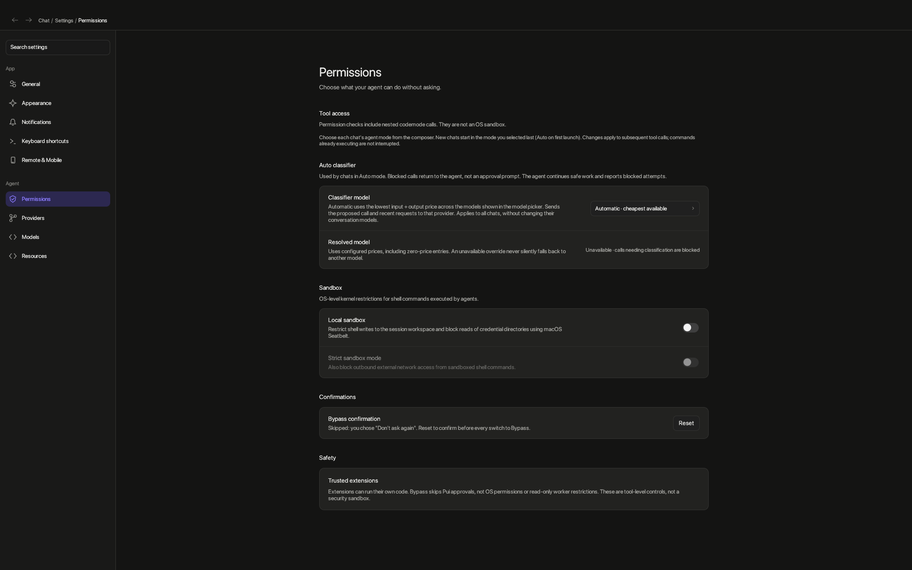

## Build from source

You need Rust 1.88+, CMake and Ninja (`brew install cmake ninja`).

```sh
cargo run -- --demo              # a populated design preview; never starts Pi
cargo run -- --demo-workflow     # dynamic workflows, background tasks & agent results preview
cargo run -- --demo-pr           # Pull Request pane, CI checks & Auto-fix preview
cargo run -- --demo-turn-ux      # live plan strip, wrap-up box & session proposal preview
cargo run -- --demo-shell-run    # single-line shell Run button & terminal deep link preview
cargo run -- --cwd /path/to/repo # open a real project
./scripts/bundle-macos.sh        # optimized Pui Dev bundle at dist/Pui.app
```

Local bundles use `dev.pi.pui.dev` / **Pui Dev** (also with `--debug`), separate
from installed **Pui** so macOS notification clicks route to the right app.
Release packaging requires an explicit `./scripts/bundle-macos.sh --distribution`;
see [releases](docs/releases.md#local-bundle-identity-and-notification-routing) for
existing local copies and notification permissions.

Tests: `scripts/test-rust.sh` and `node --test tests/*.test.mjs`. See [test execution](docs/test-execution.md).

## Learn more

- [Cloud agents host guide](docs/cloud-host-oracle.md)
- [Mobile companion guide](mobile/README.md), and [remote protocol spec](docs/mobile-remote-protocol.md)
- [Full reference](docs/reference.md): every feature and design decision in detail
- [Bundled runtime](docs/bundled-runtime.md): what ships inside the app and how providers are set up
- [Releases and CI](docs/releases.md): how builds are signed and published
- [Changelog](CHANGELOG.md)

Pui is built and tested on Apple Silicon macOS. Linux and Windows are not supported yet.
